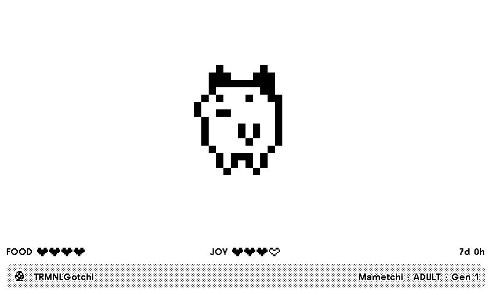

# TRMNLGotchi

Your nostalgic friend on TRMNL. A P1-style virtual pet that hatches, eats, plays, sleeps and evolves with an automatic caretaker. Care history shapes each generation; TRMY can appear as an alternative perfect-care adult.

<a href="https://trmnl.com/recipes/510825"></a>

[Install on TRMNL](https://trmnl.com/recipes/510825)



[All layout previews](TRMNL/README.md#previews).

## Settings

- No custom inputs or external account needed. Sleep follows your TRMNL account time zone.
- Use Static data `{}`, Framework 3.4.3, Node Serverless and a 15-minute refresh interval.

Full, half horizontal, half vertical and quadrant layouts show food, joy, age and generation on TRMNL OG and TRMNL X, including portrait. Force Refresh preserves the pet; Clear Saved State starts a new life.

## Develop locally

Install [trmnlp](https://github.com/usetrmnl/trmnlp), then run from the repository root:

```sh
cd TRMNL
trmnlp serve
```

The local preview uses a fixed cheerful TRMY fixture. For the simulated lifecycle, selectable characters and verification commands, see the [development guide](https://github.com/taichikuji/trmnl-tamagotchi-plugin/wiki/Development). Templates and settings live in [TRMNL/src/](TRMNL/src/); the [plugin guide](TRMNL/README.md#setup) covers importing and pet behavior.

Based on [P1 reverse engineering](https://github.com/agg23/tamagotchi-disassembled) and [research findings](https://rhubarbtart.neocities.org/p1hackinglog). See the [lifecycle rules](https://github.com/taichikuji/trmnl-tamagotchi-plugin/wiki/Lifecycle-rules) and [artwork sources](https://github.com/taichikuji/trmnl-tamagotchi-plugin/wiki/Research-and-sources).

## Trademark and artwork notice

TRMNLGotchi is an unofficial fan project made out of nostalgia. Tamagotchi is a trademark of BANDAI Co., Ltd.; its characters, logos, and original artwork belong to BANDAI. This project is not affiliated with, sponsored by, or endorsed by BANDAI or Bandai Namco. See [BANDAI's official Tamagotchi IP information](https://tamagotchi-official.com/us/anti-counterfeiting/).

The MIT license covers this project's original implementation code and documentation. Third-party artwork and trademarks retain their own terms; see [LICENSE](LICENSE). No ROM or firmware source is included.

[Questions or ideas?](https://github.com/taichikuji/trmnl-tamagotchi-plugin/issues) · [License](LICENSE)
