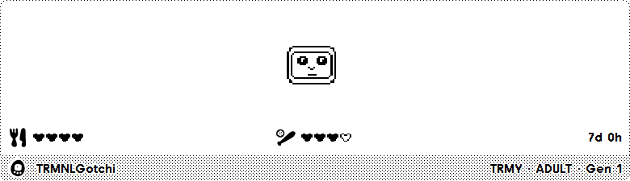
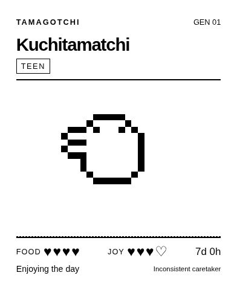
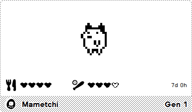
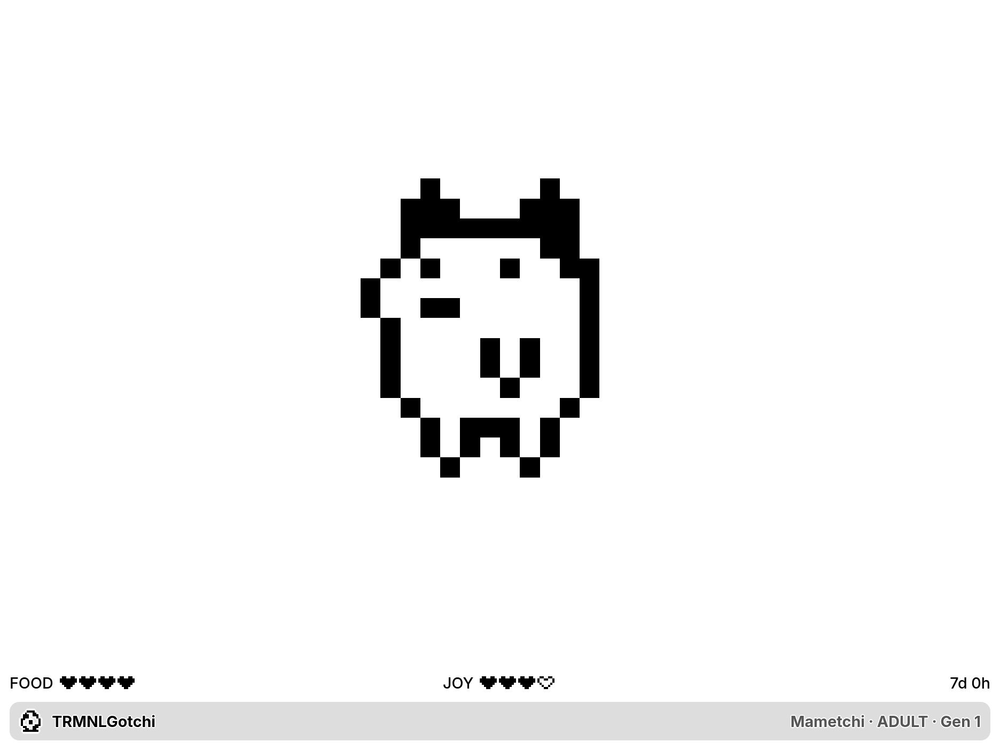

# Tamagotchi for TRMNL

An autonomous P1-style companion for your e-ink screen.

## Previews

| Full View | Half Horizontal View |
|---|---|
|  |  |

| Half Vertical View | Quadrant View |
|---|---|
|  |  |

| TRMNL X Landscape | TRMNL X Portrait |
|---|---|
|  |  |

These are local previews of the actual templates using the official TRMNL Framework 3.4.3 stylesheet and fonts. They do not prove hosted or physical-device rendering.

## Setup

You need a TRMNL account with the Developer add-on or a BYOD license.

### Import

From the repository root, run:

```sh
python3 scripts/package-import.py
```

Select **Plugins → Private Plugins → Import new**, then choose `dist/trmnl-tamagotchi-plugin.zip`. It contains `settings.yml`, the five Liquid files, and `transform.js` directly at the archive root. Do not import GitHub's source archive or the earlier whole-project archive.

The package layout is checked locally. Actual hosted import and execution remain unverified until account-side testing.

### Manual setup

1. Create a Private Plugin with **Static** strategy and Static Data `{}`. Set its refresh interval to **15 minutes**.
2. In **Edit Markup → Serverless**, choose **Node** and paste all of [`src/transform.js`](src/transform.js). It includes the simulation and sprites and defines `run(input)`. No other JavaScript file or build step is needed.
3. Select **Framework 3.4.3**. Paste [`shared.liquid`](src/shared.liquid) into **Shared** and the four corresponding templates into their layout tabs.
4. Sleep uses `trmnl.user.time_zone_iana`. If unavailable, add the optional string custom field `timezone` from [`settings.yml`](src/settings.yml), e.g. `Europe/Madrid`. Missing metadata later preserves the saved timezone; a new pet with none uses UTC with a reminder.
5. Save, enable debug logs, and add the plugin to your playlist.

## Layout

The pet sits in open space, with food, joy, and age directly above the native title bar. Full and horizontal views include the stage and generation beside the character name. Narrow views keep the name and generation. The counter is written as “Gen 1” and increases after each automatic rebirth. Sleep has a visible Z; illness, rebirth countdowns, and configuration warnings appear only when relevant.

Plugin markup uses native framework layout, flex, spacing, sizing, and typography utilities. The banner uses the unmodified `title_bar`, `image`, `title`, and `instance` classes as a sibling of `layout`; its background, borders, height, and fonts come from the framework. There are no custom stylesheets, inline styles, browser scripts, or external artwork requests. SVG artwork uses `shape-rendering="crispEdges"`; hearts are SVG paths so fonts do not change their appearance. Preview-only CSS positions and crops the device canvas and is never included in the plugin ZIP.

## Account-side acceptance checks

- Confirm a first render creates an egg and saves `trmnl.state.version = 1`, `born`, `seed`, and `cursor`.
- Let **two scheduled 15-minute refreshes** run. `cursor` must advance while the birth timestamp and seed remain stable. Babytchi should appear at the first scheduled refresh.
- Use **Force Refresh**. It must preserve the life even if previous merge variables are cleared. Rendering twice in one minute must not advance the simulation.
- Use a mashup from the **same plugin instance**. It must show the same pet. Separate installations have separate lives.
- Check all four views on OG and X, local sleeping times, debug logs, and any import errors before treating the hosted plugin as validated.

## GitHub publishing workflow

The repository follows the `TRMNL/src` and `TRMNL/media` conventions of the other plugins. **Publish to TRMNL** is manual (`workflow_dispatch`) until a target installation and hosted behavior are validated. It expects repository secrets `TRMNL_API_KEY` and `TRMNL_PLUGIN_SETTING_ID` (the integer in `/plugin_settings/<ID>/edit`). Do not commit either value. A Git push alone does not deploy this prototype to TRMNL.

## Local development

Run `node TRMNL/check.cjs` from the repository root. Node 20+ runs simulation and template checks; Python 3's standard library is used for the import-archive check. No package installation is required.

`node scripts/preview.cjs` starts a dependency-free preview at **http://127.0.0.1:8766**. Its first launch downloads the official framework release and fonts into the ignored `.cache/` directory; subsequent launches work offline. Python 3 is used for this one-time download. The preview provides the native screen and mashup wrappers, including X’s 1.8 physical-pixel scale. The local-only `.cjs` files are development tools; the deployable `src/` contains only `transform.js` as JavaScript.

For TRMNLP, open this folder and run `trmnlp serve`. `.trmnlp.yml` disables the local transform and provides a fixed Mametchi artwork fixture; use the lifecycle preview or hosted plugin to exercise growth. The setting affects local previews only.

## Lifecycle notes

Care and discipline mistakes determine evolution. A fresh caretaker tendency is seeded for each generation. The pet dies according to the modeled P1 conditions and produces another egg one simulated hour later. That interval can pass unseen during downtime.

State advances in elapsed UTC minutes. A run catches up at most 120,000 minutes (~83 days); longer gaps keep their cursor and finish on later refreshes. Invalid state raises an error instead of silently resetting the pet. **Clear Saved State** deliberately starts over; Force Refresh does not.

See the [rules and adaptations](../docs/RULES.md) before describing the prototype as faithful. It is a researched behavior model, not a cycle-accurate firmware emulator. Bandai retains the original artwork; public recipe publication remains deferred.
