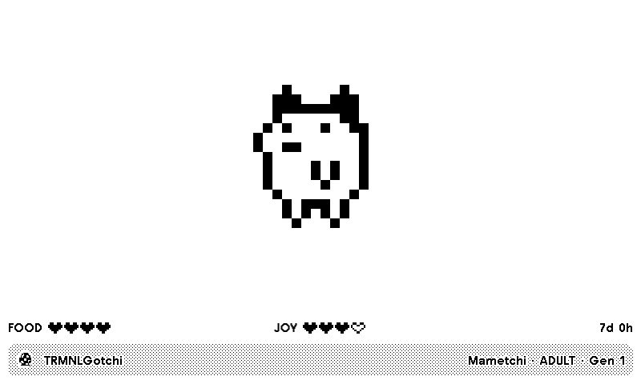
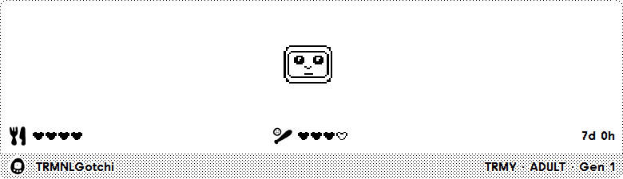
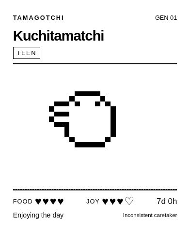
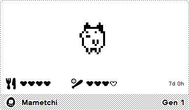
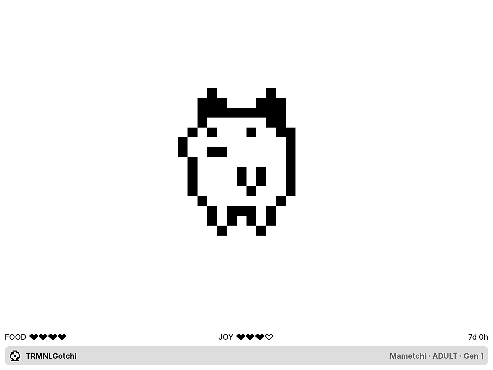
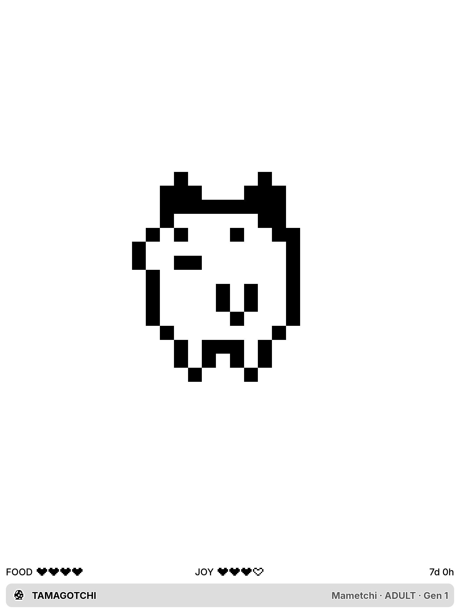

# TRMNLGotchi

A TRMNL plugin that raises a nostalgic P1 or P2 virtual pet. It hatches, eats, plays, sleeps and evolves with an automatic caretaker.

## Icon

<div align="center">
  
</div>

## Previews

Previews show TRMY in different care states, rendered with Framework 3.4.3.

| Full View · Cheerful | Half Horizontal View · Playing |
|------------|----------------------|
|  |  |

| Half Vertical View · Having a Meal | Quadrant View · Needs Cleaning |
|-------------------|----------------|
|  |  |

| TRMNL X Landscape · Sleeping | TRMNL X Portrait · Under the Weather |
|-------------------|------------------|
|  |  |

## Templates

- **transform.js**: Simulation, seeded care, evolution, saved state and original sprite data.
- **shared.liquid**: Shared icons, pet artwork, needs, notices and title bar. Each layout supplies its sizing and banner options.
- **full.liquid**: Centered pet, food, joy and age, with the character, stage and generation in the title bar.
- **half_horizontal.liquid**: The same information in a shorter horizontal view.
- **half_vertical.liquid**: Pet and needs with the character name and generation in the title bar.
- **quadrant.liquid**: Compact pet and needs for the smallest slot.

All four layouts use native Framework 3.4.3 utilities and crisp SVG artwork. Serverless and Saved State keep the simulation inside TRMNL; no external service or runtime dependencies are required.

## Setup

Install the [published recipe](https://trmnl.com/recipes/510825) and add it to your playlist. Each installation has its own pet and saved progress; two devices using the same installation show the same pet. Separate pets need separate installations.

### Private import or manual setup

Create a Private Plugin with **Static** data `{}`, Framework **3.4.3**, **Node** Serverless and a **15-minute** refresh interval. Private plugins require Developer or BYOD access.

Generate the import package from the repository root:

```sh
python3 scripts/package-import.py
```

In TRMNL, choose **Plugins → Private Plugins → Import new** and upload `dist/trmnl-tamagotchi-plugin.zip`. This script creates the flat archive TRMNL expects. Upload [media/icon.svg](media/icon.svg) in the plugin settings for the orange listing icon.

For manual setup, copy the values from [settings.yml](src/settings.yml) into the dashboard, paste [shared.liquid](src/shared.liquid) into Shared and each layout into its matching markup tab. Paste the complete [transform.js](src/transform.js) into **Serverless** and select **Node**.

Save, Force Refresh and add the plugin to your playlist. Sleep follows your TRMNL account time zone automatically; no time zone input is needed. If TRMNL temporarily omits it, the pet keeps its saved time zone. A new installation without usable time zone metadata displays **Time zone unavailable · sleep uses UTC** until account metadata becomes available.

### Existing installs showing the author's pet

The original recipe had only an About field. TRMNL [reuses the recipe master's screens when there are no input fields](https://help.trmnl.com/en/articles/16777795-saved-state), leaving the install's saved state empty. The hidden `pet_instance` input enables a separate simulation without asking the user to choose a pet. Keep this field and its `my_own_pet` default in the recipe; the About field alone is insufficient.

Existing independent installations retain their progress when the visible selector becomes hidden. Originally mirrored copies did not convert automatically or after saving settings in the hosted test. After the updated recipe is published, use **Install again** to create a new copy and add it to your playlist. Confirm the new copy progresses independently before removing the old playlist entry.

An empty save starts at **Egg · Gen 1** and hatches after five elapsed minutes, visible on the next refresh. Existing valid saves continue unchanged. Do not use **Clear Saved State** to apply this fix: that resets an actual pet and does not address shared recipe screens.

Hosted tests covered new installs, saved-state persistence and upgrades using one account's BYOD device. See [issue #6](https://github.com/taichikuji/trmnl-tamagotchi-plugin/issues/6#issuecomment-6562171727) for the results and test limits.

## Pet behavior

Each new egg chooses P1 or P2 with equal probability and gets a seeded caretaker. The family stays fixed throughout that life. Saves from before P2 support continue as P1 until rebirth; the displayed **Gen** remains the life counter, not the ROM family. Care history determines evolution, and a new egg appears one simulated hour after death. **Gen 1** is the first generation.

Progress follows elapsed time, so changing the refresh frequency does not change care decisions. Force Refresh preserves the pet; **Clear Saved State** starts a new life. See the [rule table](https://github.com/taichikuji/trmnl-tamagotchi-plugin/wiki/Lifecycle-rules) for the researched rules and adaptations, and [verification progress](https://github.com/taichikuji/trmnl-tamagotchi-plugin/wiki/Verification) for the hosted checks completed so far.

TRMY is an alternative perfect-care adult in both families. When an eligible Tamatchi (P1) or Tongaritchi (P2) teen reaches adulthood with **zero care mistakes and zero missed discipline calls**, its life seed chooses evenly between TRMY and the family's original perfect-care adult: Mametchi in P1 or Mimitchi in P2. Eligible teens with one or two care mistakes still become Mametchi or Mimitchi. All other evolution branches, including the secret adult, keep their original outcomes. The choice happens during normal evolution and is saved as the character itself; existing adults keep their current identities after updating.

TRMY has its own entry in the same character, stats, sprites and growth tables. Its hunger drops every **180 awake minutes** and happiness every **210 awake minutes**, compared with Mametchi's 81 and 91. It sleeps **22:00–09:00** in the account time zone, starts fully disciplined, and takes one medicine dose per treatment. Illness and adult aging countdowns are both 4,095 awake minutes, within the original P1 timer ranges. It uses the same cleanup, illness, aging, death and rebirth mechanics as the other pets. Aging eventually accelerates its needs too.

TRMY's eight expressions are complete 32×32 pixel poses in `TRMY_SPRITES`. **Unamused** and **cheerful** alternate at the original 15-minute idle cadence; care states and recent activities select the other expressions:

| Expression | When it appears |
| --- | --- |
| Unamused / cheerful | Ordinary idle poses |
| Sleepy | Sleeping, with the original Z indicator |
| Fainted | Illness |
| Squinting | Cleanup is pending, beside the original poop indicator |
| Skeptical | Discipline calls, empty food/joy, or just after scolding |
| Delighted | Having a meal, freshly cleaned, or recovering after medicine |
| Starry | Playing a game |

Sleep takes priority over illness, then cleanup, then discipline/empty needs, then activity reactions. Brief meal, play and successful-care reactions remain visible for up to **15 simulated minutes** so a normal refresh can catch them. This display-only extension uses the existing activity timestamp; care timings, random decisions and saved-state fields are unchanged.

Only the current expression's path is sent to the display. A `scale(0.5)` transform fits its native detail into the existing 16-unit character tile. Poop and discipline indicators reuse the original artwork. TRMY uses the same expressions and stats in both families. The extraction script assembles upper and lower ROM tiles offline. Complete poses are stored as compact `[x, y, width]` pixel runs; only the selected pose is expanded to SVG at each refresh, keeping the Serverless file below TRMNL's 100 KB upload limit.

Run `node scripts/preview.cjs` from the repository root and select **trmy** or **p2-trmy** in the local preview to inspect it. Production character selection follows care history and evolution.

## P1/P2 artwork and animation

The supplied P1 and Japanese first-series P2 ROMs each provide **142 distinct complete body poses** and **132 character/action sequences** (12 character slots × 11 actions). Extraction includes canonical table poses, mixed upper/lower poses, mirrored tiles, original holds and loop points. Egg, hatching, sleep, illness, meals, games, reactions and the regional death sprite are included, together with both sleep and poop indicator frames. TRMY keeps its supplied custom artwork.

| P1 | P2 (supplied Japanese ROM) |
| --- | --- |
| Babytchi / Marutchi | Shirobabytchi / Tonmarutchi |
| Tamatchi / Kuchitamatchi | Tongaritchi / Hashitamatchi |
| Mametchi / Ginjirotchi / Maskutchi | Mimitchi / Pochitchi / Zuccitchi |
| Kuchipatchi / Nyorotchi / Tarakotchi | Hashizoutchi / Kusatchi / Takotchi |
| Bill | Sekitoritchi |

The supplied ROMs have matching lifecycle/stat tables for these slots, so both families share one care engine and growth chart. Identical animation sequences are stored once; every character retains its complete poses and original timing. SVG paths combine adjacent pixels without changing the artwork. Other P2 editions may have different characters and are not substituted for this ROM.

Run `node scripts/check-rom.cjs` to check the 100 KB source budget, pixel runs, animation timing, evolution, family selection, saved-state compatibility and all local preview combinations. These checks do not require ROM files.

TRMNL displays one sampled pose per refresh. Idle uses 15-minute slots; recent care reactions use the existing activity timestamp. This preserves the extracted sequences without requesting rapid e-ink refreshes. Every extracted pose and all eleven action sequences can be inspected in `node scripts/preview.cjs`: choose a character, **All extracted poses** or **ROM animation 0–10**, then change **ROM pose / tick**. Numeric action slots also include sequences unused by passive care; extraction does not add manual care controls.

### Reproducing extraction

No ROMs or generated firmware code are checked in. With the supplied ROMs and an external [tamarecomp](https://github.com/sp00nznet/tamarecomp) checkout, generate a C CPU for each ROM using its `emit.py`, then compile a tracing executable for each generated C file:

```sh
cc -O0 -DTAMA_TRACING -I/path/to/tamarecomp/include /path/to/p1.c /path/to/tamarecomp/src/hw.c scripts/trace-rom-sprites.c -o /tmp/trace-p1
cc -O0 -DTAMA_TRACING -I/path/to/tamarecomp/include /path/to/p2.c /path/to/tamarecomp/src/hw.c scripts/trace-rom-sprites.c -o /tmp/trace-p2
/tmp/trace-p1 /path/to/tama.b > /tmp/p1.trace
/tmp/trace-p2 /path/to/tamag2.bin > /tmp/p2.trace
python3 scripts/extract-reference.py /path/to/tama.b /path/to/tamag2.bin /tmp/p1.trace /tmp/p2.trace
```

The standard-library extractor checks both ROM SHA-1s, verifies each trace's ROM fingerprint and requires all 132 terminating traces before replacing the generated `ROM_SPRITES` block. The tracer executes the ROM controller at `0x0465`/`0x0486` and resolves its upper/lower draws at `0x0928`/`0x0939`. Regeneration is deterministic.

## Character appearance rates

**Historical P1-only sample; these are not current combined P1/P2 appearance rates.**

A simulation of **10,000 complete lives** at [commit `a288353`](https://github.com/taichikuji/trmnl-tamagotchi-plugin/commit/a288353d7c74129507a28acf9389e08d2bc0bf1d) produced the results below. Each life started as a fresh egg and ran until its first death, using the normal automatic caretaker, varied seeds and start times across October 18, 2026 (UTC), and the `Europe/Madrid` time zone.

Each percentage is the share of all 10,000 lives that reached that character at least once. The percentages overlap because a life passes through several characters; a life reaching Bill also counts toward Maskutchi. These are estimates for the sampled conditions, and an existing life follows its saved seed and care history.

| Character | Lives reaching character | Percentage |
| --- | ---: | ---: |
| Egg | 10,000 | 100.00% |
| Babytchi | 10,000 | 100.00% |
| Marutchi | 10,000 | 100.00% |
| Tamatchi | 6,198 | 61.98% |
| Kuchitamatchi | 3,209 | 32.09% |
| Tarakotchi | 2,705 | 27.05% |
| Maskutchi | 2,142 | 21.42% |
| Bill | 1,872 | 18.72% |
| Mametchi | 1,645 | 16.45% |
| TRMY | 1,486 | 14.86% |
| Nyorotchi | 303 | 3.03% |
| Ginjirotchi | 207 | 2.07% |
| Kuchipatchi | 22 | 0.22% |

Every character appeared naturally in this sample. **1,490 lives (14.90%) ended before adulthood.**

## Trademark and artwork notice

TRMNLGotchi is an unofficial fan project. Tamagotchi is a trademark of BANDAI Co., Ltd.; its characters and original artwork belong to BANDAI. This project is not affiliated with, sponsored by, or endorsed by BANDAI or Bandai Namco. The MIT license covers original code and documentation; third-party material retains its own terms. See [LICENSE](../LICENSE) and the [full notice](../README.md#trademark-and-artwork-notice).

TRMY is the TRMNL mascot. Its supplied pixel-art redraws are separate from the original Bandai P1 artwork; adding this fan-made appearance does not imply TRMNL endorsement.

For support, [open a GitHub issue](https://github.com/taichikuji/trmnl-tamagotchi-plugin/issues). Local preview, verification and publishing instructions are in the [development guide](https://github.com/taichikuji/trmnl-tamagotchi-plugin/wiki/Development).
