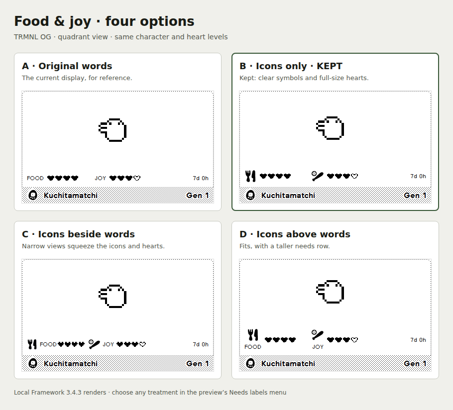

# Food and joy icons

**Kept: B, icons only.** The supplied food and joy SVGs replace the visible words in all four layouts. This gives the needs row a familiar Tamagotchi appearance, keeps the full-size hearts and leaves more room in narrow views. Food/Joy names and heart values remain available to assistive technology.

[View the same four options at full-screen size](media/needs-label-options-full.png).

| Option | Result |
| --- | --- |
| A · Original words | Baseline for comparison. |
| B · Icons only · kept | Both icons and heart meters retain their intended size in every layout. |
| C · Icons beside words | Most explicit, but the framework compresses the icons and hearts in narrow OG and X portrait slots. |
| D · Icons above words | Fits at full width, but makes the OG quadrant needs row 43 px tall instead of B's 24 px, reducing space for the pet. |

The comparison uses identical Kuchitamatchi fixtures, heart levels and native Framework 3.4.3 wrappers. In the OG quadrant, C reduces the food icon from 24 to about 20.5 px and its heart meter from 64 to about 55.4 px. B preserves both dimensions. Full view uses 28 px icons; mashups use 24 px, with native scaling on X.

## Try another option

Run `node scripts/preview.cjs` from the repository root and open **http://127.0.0.1:8766**. Use **Needs labels** to switch between all four treatments, then change the device, layout, character or pose state. The alternatives are preview options; the plugin templates keep B.

## Verification

- Browser-rendered all 48 treatment/device/layout combinations: four treatments, four layouts, OG, X landscape and X portrait. The chosen treatment had no measured needs overlap, overflow or compressed icons/meters.
- Checked ten additional compact renders: egg, rebirth, sleeping, illness and time zone warning on OG and X portrait. Notices and needs remained above the title bar.
- Exercised all four options through the preview's selector and decoded every embedded image successfully.
- Passed all 26 existing checks, including 468 template combinations and the flat import ZIP check.
- Updated all six README preview images to the chosen treatment.

These are local browser renders; physical-device appearance remains unverified.
